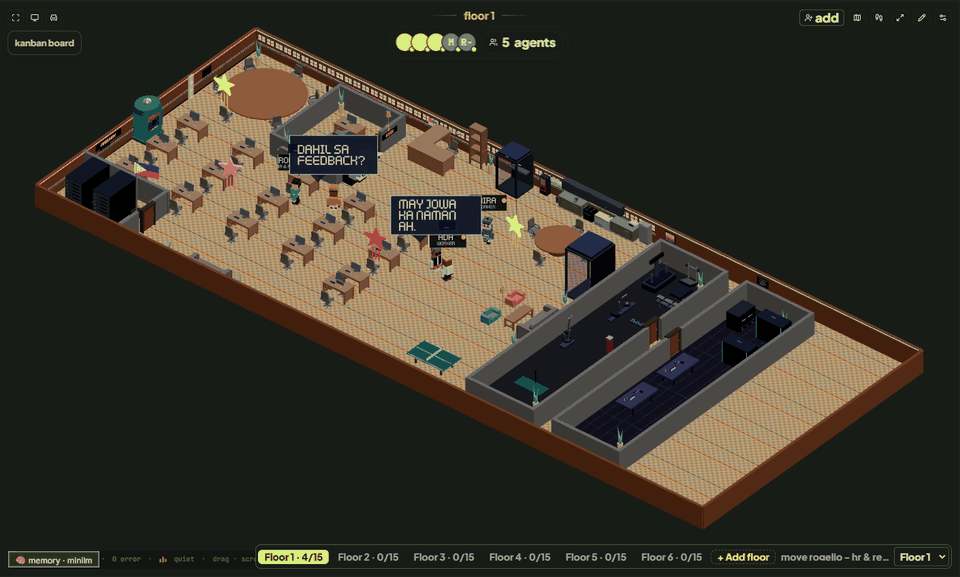
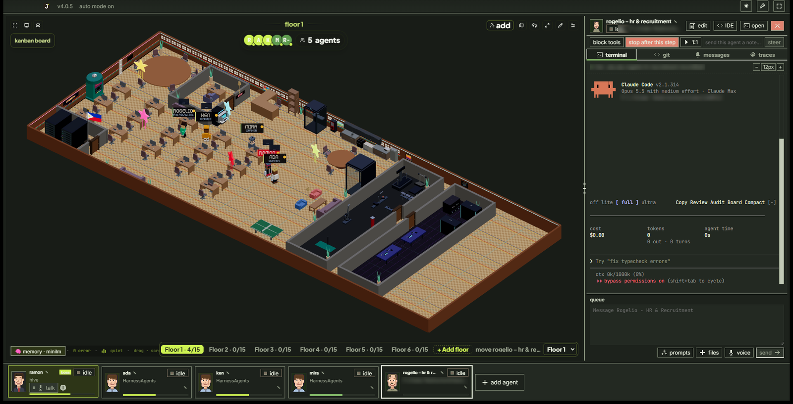

<div align="center">


# AI Guild

### An office of AI coding agents, running on your machine

**Free, open source and local-first.** A multi-agent harness that works with the AI
subscriptions you already pay for. It turns the terminal coding CLIs you already run into a
team: each agent gets a desk, a terminal, memory and an inbox, and an orchestrator named
**Roy** keeps the floor moving while you're away.

Wraps [Claude Code](https://claude.com/claude-code), OpenAI Codex, Antigravity and Gemini CLI,
**xAI Grok**, **Kimi Code**, **Qwen**, **OpenCode**, **Crush**, **pi**, **GitHub Copilot CLI** and
**Cursor**, with bring-your-own keys and local models. Philippine edition, with connectors for
**Pancake POS** and **Webcake**.

<p>
  <em>Electron · React · TypeScript · Three.js (React Three Fiber) · xterm.js · node-pty</em>
</p>

<p>
  <a href="./LICENSE"></a>
  <a href="./CHANGELOG.md"></a>
  
  
  <a href="./CONTRIBUTING.md"></a>
  <a href="https://maaramid.github.io/ai-guild"></a>
</p>

**[⬇ Download for macOS, Windows or Linux](https://maaramid.github.io/ai-guild/#download)**

<sub>No account, no sign-in, no license key. Every installer is on the
<a href="https://github.com/maaramid/ai-guild/releases/latest">releases page</a>.</sub>

**New here?** Start with the [User Guide](./docs/USER_GUIDE.md).

<sub>A rebrand of <a href="https://github.com/jeffreycayao/Dev-Labs"><b>DevLabs</b></a> by <a href="https://jepoy.dev">Jeffrey Cayao</a>, itself a fork of <a href="https://github.com/HarnessMD/munder-difflin"><b>Munder Difflin</b></a> by
<a href="https://github.com/chaitanyagiri">Chaitanya Giri</a>, released under the same MIT License.</sub>

</div>

<p align="center">
  
</p>

<p align="center">
  
</p>

## New in AI Guild: Meta Ads team

Two extra roles in **Add agent → templates**: **Kazuma - Meta Ads Specialist** (audits, results
reading, campaign plans) and **Emilia - Creative Strategist** (customer research, angles, hooks,
scripts, briefs, test plans). Every agent also gets the bundled Meta Ads skills:
`meta-ads-market-research`, `meta-ads-creative-strategy`, `meta-ads-audit` and
`meta-ads-metrics-reader`. Turn on the **Meta Ads** connector to let them read your ad account.

## New in AI Guild: the 2D guild hall

The office is now a light **2D guild hall** (canvas, no 3D engine): working agents sit at
their desks in the work hall, idle ones hang out in the tavern, courtyard and great hall, and
Roy runs things from the office of the guild master. The cast are anime-style people; their looks
live in `src/renderer/src/scene/office/animeArt.ts` (`ANIME_LOOKS`). The old 3D office is still
there: **Settings → General → Features → 3D office**.

## Use it in 5 minutes (no coding needed)

1. **Install an AI tool you like and sign in to it.** Claude Code is the easiest start. AI Guild uses your own AI account; it doesn't sell AI.
2. **Download AI Guild** from **[maaramid.github.io/ai-guild](https://maaramid.github.io/ai-guild/#download)** and open it.
3. **Answer the 4 quick setup questions.** The suggested answers are fine. Choose **ask first** if you want agents to check with you before they change anything.
4. **Click Roy** (the manager with the red name tag) and type what you want in plain words, for example *"Make a one-page website for my bakery, as an HTML file."*
5. **Watch the office.** An agent walks to its desk and gets to work. When it's done, your file appears in Roy's **deliveries** tab. Approve it, or ask for changes.

Everything else is in the **[plain-language User Guide](./docs/USER_GUIDE.md)**.

---

> [!NOTE]
> **Your agents, one office, one manager.**
> AI Guild takes the terminal-agent CLIs you already run (`claude`, `codex`, `agy`, `gemini`,
> `grok`, `kimi`, `qwen`, `opencode`, `crush`, `pi`, `copilot` and `cursor-agent`) and turns them into
> a self-coordinating team: each agent gets long-term memory, a mailbox and a desk in a 3D
> office, and **Roy** at the head desk plans the work and hands it out while you watch.
> He runs the floor; you still run him.

## Contents

- [Supported agents](#supported-agents)
- [What it is](#what-it-is)
- [How it works](#how-it-works)
- [Features](#features)
- [Getting started](#getting-started)
- [Architecture](#architecture)
- [Roadmap](#roadmap)
- [Contributing](#contributing)
- [Telemetry](#telemetry)
- [License](#license)
- [Acknowledgements](#acknowledgements)

## Supported agents

**Bring the CLI you already pay for.** Every one of these runs as a real process in its own
terminal, on your existing subscription and its limits. If it runs in a terminal, it can run here.

<p>
  <a href="https://docs.claude.com/en/docs/claude-code"><kbd>Claude Code</kbd></a>
  <a href="https://github.com/openai/codex"><kbd>Codex · GPT</kbd></a>
  <a href="https://antigravity.google/docs/cli-overview"><kbd>Antigravity · Gemini</kbd></a>
  <a href="https://github.com/google-gemini/gemini-cli"><kbd>Gemini CLI</kbd></a>
  <a href="https://x.ai/cli"><kbd>Grok · xAI</kbd></a>
  <a href="https://www.kimi.com/code"><kbd>Kimi Code</kbd></a>
  <a href="https://github.com/QwenLM/qwen-code"><kbd>Qwen</kbd></a>
  <a href="https://opencode.ai/docs"><kbd>OpenCode</kbd></a>
  <a href="https://github.com/charmbracelet/crush"><kbd>Crush · Charm</kbd></a>
  <a href="https://pi.dev/docs/latest"><kbd>Pi</kbd></a>
  <a href="https://docs.github.com/copilot/concepts/agents/about-copilot-cli"><kbd>GitHub Copilot</kbd></a>
  <a href="https://cursor.com/docs/cli/install"><kbd>Cursor</kbd></a>
  <kbd>+ any custom command</kbd>
</p>

Plus **any model through OpenCode, Crush or pi**: GLM (Z.ai Coding Plan), DeepSeek, and local
models through Ollama.

## What it is

AI Guild is a desktop app that wraps **real terminal-agent CLIs** as fully capable agents,
wires them into a **hive** of shared files, and puts **Roy**, the orchestrator, in charge. Roy
is the one agent *you* brief to get things done.

- **Every terminal is an agent.** Each `claude`, `codex`, `agy`, `grok`, `opencode` or custom session
  runs as a real process in a pseudo-terminal (`node-pty`), rendered with xterm.js.
- **Every agent is an avatar.** Sessions appear as characters in a 3D office (Three.js), with a
  Philippine flag, a BOSS office for Roy and Pinoy office chismis.
- **The hive coordinates them.** Agents read their memory and drain a mailbox; the router moves
  messages between inboxes; Roy assigns, adjudicates and escalates only what needs you.
- **Memory that lasts.** Markdown memory per agent, mined into a shared, searchable store, so agents
  remember across sessions.

## How it works

```
            you ── talk to ──►  ┌─────────────┐
                                │    Roy    │  orchestrator at the head desk
                                │ (god agent) │  roster · routing · adjudication
                                │             │  board · task ledger
                                └──────┬──────┘
                                       │ assigns · routes · escalates
              ┌────────────────────────┼────────────────────────┐
              ▼                         ▼                         ▼
        ┌───────────┐            ┌───────────┐            ┌───────────┐
        │  agent A  │  message   │  agent B  │  message   │  agent C  │
        │ provider  │ ─────────► │ provider  │ ─────────► │ provider  │
        │  + memory │            │  + memory │            │  + memory │
        └───────────┘            └───────────┘            └───────────┘
              └──────── shared hive: memory · mailbox · board · log ────────┘
```

1. **You hire agents**: each is a normal terminal process with its own working folder, identity and
   engine.
2. **Agents collaborate through the hive**: a local git repo of plain files. They write to their own
   `outbox/`; the router delivers into the recipients' `inbox/`. Only the harness commits, so agents
   never fight over git's lock.
3. **Roy runs the floor**: he reads every request, settles routine ones himself and escalates only
   the critical ones (spend, destructive operations, scope changes) to you.
4. **Everything is visible**: watch the floor, read any terminal live, type back into it, browse its
   files and its git history.

See [`HIVE.md`](./HIVE.md) for the multi-agent design, [`SPEC.md`](./SPEC.md) for the terminal and
event plane, and [`DESIGN.md`](./DESIGN.md) for the visual system.

## Features

<table>
<tr>
<td width="50%" valign="top">

### Talk to one agent, not twelve

Roy is the only agent you brief. He plans the work, hands it to the right agent, routes the
traffic between them and escalates the few things that actually need you. Turn on **Talk** to
brief him by voice.

</td>
<td width="50%" valign="top">

### Hire a whole team as one file

A **floor** is a team of agents you can import or export as one `.floor.json` file or an
`aiguild://floor` link. Try the ready-made **Online Seller Team**: a shop manager, a landing-page
designer and a product copywriter. See [FLOORS.md](./.documentations/FLOORS.md).

</td>
</tr>
<tr>
<td width="50%" valign="top">

### Hire one agent in a few clicks

Pick the engine, the model and the autonomy, give it a desk, and it starts working. Share a single
agent as a **hire** manifest or link; importing only fills in the form, and you still press start.
See [docs/hires](./docs/hires/).

</td>
<td width="50%" valign="top">

### Let agents work in your shop

**Connections** let agents work inside Pancake POS (orders, products, stock, sales), Webcake
(landing pages), Metricool, Meta Ads, GitHub and more, or any MCP server you add yourself. Keys stay
encrypted on your computer, and for hosted connectors the agent never sees the key at all. See
[CONNECTORS.md](./.documentations/CONNECTORS.md).

</td>
</tr>
<tr>
<td width="50%" valign="top">

### A whole building, not just one floor

Open a new floor for another repo or folder, each with its own agents, tasks and memory, up to
**200 floors** at once. Roy manages the building, and agents on different floors can message
each other.

</td>
<td width="50%" valign="top">

### Autonomy with a leash

Set how far each agent may go on its own. Token budgets per agent and per floor, approvals for
spend and destructive operations, and a circuit breaker that steers, constrains, then stops anything
that loops or runs away.

</td>
</tr>
<tr>
<td width="50%" valign="top">

### Finished files come back to you

Agents hand back finished work (HTML, Markdown, PDF, DOCX, images, spreadsheets, slides) as
**Deliveries**. Review them in the Command Center tray and save them where you want.

</td>
<td width="50%" valign="top">

### Set up once

The onboarding wizard checks what you already have and offers to install what's missing. A missing
CLI shows as an **Install** card in the agent's terminal instead of an error.

</td>
</tr>
</table>

**The floor**
- **Every terminal is a real agent.** Twelve engines or a custom command, each in its own PTY, rendered with xterm.js.
- **Any OpenRouter model per agent.** OpenCode, Crush and Pi agents pick from OpenRouter's live list with a Free / Paid switch and the price per million tokens.
- **Every agent is an avatar** in a 3D office, with desks, a kitchen, a gym, a QA lab, a server room and a BOSS office for Roy.
- **Office floors you can add and delete.** Up to 15 agents per office floor; **+ Add floor** opens a new one and **− Delete floor** removes an empty one (the floors above move down, keeping their layouts).
- **Per-agent git worktrees.** Optional isolation so parallel agents never collide on a branch; the base checkout's `node_modules` is linked in.
- **New project floor.** Settings → General opens a clean floor for an existing repo or folder.
- **Reset with backup.** Clear a floor's agents, tasks and memory, with an optional restorable ZIP.
- **A building you can ride.** Floors are stacked like a building with status-lit windows; click one and an elevator takes you there. Smooth zoom and pan, and the scene only redraws when something moves.
- **Office themes.** Export the layout as one `.office-theme.json`, import one (checked against a strict schema, with a preview, backup and undo), or let your own AI design one. Themes can add trees, flowers, water, fences and birds, restyle the ground, walls, sky and light, and hide the standard rooms.

**Memory and coordination**
- **The hive**: per-agent memory, atomic-file mailboxes, a shared board, an append-only event log and single-committer git.
- **Shared memory search** across every agent, plus a knowledge graph of your own documents.
- **Restart & Continue**: redraw a garbled terminal without losing the conversation.
- **Context handoff**: instead of `/compact`, an agent can write a short handoff to its memory, clear its session and continue from it (Triggers → Context → Compact → Method). The clear only happens once the handoff is saved.
- **Agent Browser**: agents drive a real headless Chrome (Vercel's agent-browser) to open, read and use websites, each in its own session. On by default; one switch turns it off.
- **268 ready-made personas** from agency-agents, plus freelancer roles (client relations, proposals, contracts, invoicing, portfolio) and six AI Guild skills (3D games, Three.js, Anime.js, UI/UX, DevOps, security research).
- **ATTITUDE.md**: write once how agents should talk to you; every new agent follows it.

**Control and safety**
- **Human gates**: spend, scope and destructive operations come to you. Steer mid-run or stop gracefully.
- **Circuit breaker**: a steer → constrain → stop ladder for agents that loop, repeat errors or blow their budget.
- **Budgets and cost**: per-agent token caps, real cost read from transcripts, and each agent's prompt-cache hit rate.
- **Your keys never reach agents**: every key is encrypted by your OS. Connector keys and AI provider keys (for OpenCode, Crush, Pi, Qwen) go through a local proxy, so agents only get a temporary pass.
- **Feature switches**: Settings → General → Features turns each optional feature off.
- **Resource use**: Settings → General shows AI Guild' CPU and memory per agent. Firing an agent closes everything it started, and Roy can fire agents for you.

**Command Center**
- Kanban tasks, an **Ask me** inbox for agent questions, weekday schedules, live fleet monitoring, memory search, activity log and Deliveries.
- **Skills**: browse and install skills from the [AI Guild skills repository](https://github.com/jeffreycayao/atmt_labs_floor_agentskills). Each file is checked against a pinned commit and SHA-256 hash.
- **Built-in Monaco IDE**: file tree, editor tabs and git rails (changes, history, compare) with a commit graph and diffs.

**Getting work in and out**
- **Slack and webhooks**: message a channel or POST a webhook, and Roy picks up the work and replies in the thread. Only Slack users on your allowed list can start work. Inbound servers listen on your computer only and are reached through a tunnel.
- **Voice**: talk to Roy through OpenAI's Realtime API or Google's Gemini Live with your own key, or dictate into the message box with Free Flow (Groq Whisper).
- **Your language**: English, Simplified Chinese and Arabic, with right-to-left layout for Arabic.
- **Updates in one click** from the public releases feed; no GitHub account or token needed.

<div align="right">(<a href="#aiguild">↑ back to top</a>)</div>

## Getting started

### Download the app

**Most people want this one.** AI Guild is free and open source, with no account or sign-in.
Installers for macOS, Windows and Linux are on [maaramid.github.io/ai-guild](https://maaramid.github.io/ai-guild/#download) and the
[releases page](https://github.com/maaramid/ai-guild/releases/latest). Install it,
open it, and the wizard takes you the rest of the way.

You still need at least one agent CLI on your computer, signed in with that company's account.
**Settings → Prerequisites** lists what's missing.

### Build from source

Everything below is for contributors and for people who want an unreleased build.

#### Prerequisites

- **macOS, Windows or Linux**.
- **Node.js 18+** and npm.
- A **C/C++ toolchain** for the native modules (`node-pty`, `better-sqlite3`): Xcode Command Line
  Tools on macOS, **Visual Studio Build Tools (C++ workload)** on Windows.
- At least one supported agent CLI on your `PATH`.

#### Install and run

```bash
git clone https://github.com/maaramid/ai-guild.git
cd AI-Guild
npm install        # postinstall rebuilds the native modules against Electron
npm run dev        # launches the app with hot reload
```

No toolchain on Windows? Install with `npm install --ignore-scripts`, run
`node node_modules/electron/install.js`, fetch the prebuilt SQLite binary with
`npx prebuild-install --runtime electron --target <electron-version>` inside
`node_modules/better-sqlite3`, then run `node tools/patch-node-pty-conpty.cjs`.

#### Other scripts

| Script | What it does |
| --- | --- |
| `npm run typecheck` | TypeScript checks (main + renderer) |
| `npm run test:focused` | Node test suite |
| `npm run build` | Production build |
| `npm run dist` | Build installers into `dist/` |
| `npm run version:patch` / `:minor` / `:major` | Raise the app version before every source push. See [RELEASE.md](RELEASE.md) |

> If `node-pty` fails to load after an Electron upgrade, run `npm install` again (the `postinstall`
> hook rebuilds it against the current Electron).

## Architecture

Two data planes feed one renderer: a **terminal plane** that owns the PTYs, the filesystem and git,
and an **event plane** that runs the hive, the hook server and the router. The renderer reaches both
only through one typed bridge (`window.cth`).

The diagrams and the module-by-module map are in [`docs/ARCHITECTURE.md`](./docs/ARCHITECTURE.md).
Contributors and AI coding agents should read [`AGENTS.md`](./AGENTS.md) first. Brand names, slugs
and the release repo are in [`src/shared/brand.ts`](./src/shared/brand.ts); colors in
[`src/renderer/src/design/tokens.css`](./src/renderer/src/design/tokens.css).

<div align="right">(<a href="#aiguild">↑ back to top</a>)</div>

## Roadmap

Shipped through **v3.0.0**: open source under MIT with no account, the J monogram rebrand, new
project floors, agents that stay hired, Deliveries, a building of up to 200 floors, floors and hires
as shareable files, Pancake POS and Webcake connectors, the skills library, Restart & Continue for
every engine, and English, Simplified Chinese and Arabic. Full history in
[`CHANGELOG.md`](./CHANGELOG.md).

Next up:

- [ ] **Connectors for every engine**: today connectors attach to Claude Code agents only.
- [ ] **More Philippine business connectors** and ready-made floors.
- [ ] **One code editor**: move the remaining CodeMirror editors to Monaco.
- [ ] **Filipino interface language**.

<div align="right">(<a href="#aiguild">↑ back to top</a>)</div>

## Contributing

Contributions are welcome. Start with [`CONTRIBUTING.md`](./CONTRIBUTING.md) and
[`AGENTS.md`](./AGENTS.md). The short version: fork, `npm install && npm run dev`, keep
`npm run typecheck` and the tests green, put every UI string in all three languages, and derive any
new UI from the [`DESIGN.md`](./DESIGN.md) tokens.

Questions or bugs: [open an issue](https://github.com/maaramid/ai-guild/issues). Security
problems: see [`SECURITY.md`](./SECURITY.md).

**Everyone whose code is in this project is listed in [`CONTRIBUTORS.md`](./CONTRIBUTORS.md)**,
including Chaitanya Giri and the Munder Difflin contributors whose work this fork is built on.

## Telemetry

Official builds can send a **small set of anonymous usage events** (app opened, agent started,
feature used), never prompts, code, file paths or agent output. Turn it off in Settings or with
`DO_NOT_TRACK`; builds you compile yourself send nothing. The full event list is in
[`TELEMETRY.md`](./TELEMETRY.md), and the [Privacy Policy](./PRIVACY.md) covers the rest.

## License

> [!IMPORTANT]
> **Asset licensing.** The bundled pixel art (tilesets and maps) is **Modern Interiors - RPG Tileset
> [16X16]** by [LimeZu](https://limezu.itch.io/moderninteriors), used under the **Complete Version
> licence**. **Credit to LimeZu is required by that licence** and must stay in place. The office cast
> is not LimeZu art; it is drawn in code in `portraitArt.ts`. See
> [`src/renderer/src/assets/ATTRIBUTION.md`](./src/renderer/src/assets/ATTRIBUTION.md).

The **source code** is licensed under the **[MIT License](./LICENSE)**, © 2026 Chaitanya Giri and
jepoy.dev. The MIT grant covers the code only; the bundled pixel art is licensed
separately and carved out in [`LICENSE-ASSETS`](./LICENSE-ASSETS). Other third-party components are
listed in [`THIRD_PARTY_NOTICES.md`](./THIRD_PARTY_NOTICES.md). Claude, Codex, Gemini, Cursor and
other names belong to their owners and are used only to describe compatibility.

## Acknowledgements

- [**Munder Difflin**](https://github.com/HarnessMD/munder-difflin) by [Chaitanya Giri](https://github.com/chaitanyagiri) and its [contributors](./CONTRIBUTORS.md): the open-source harness this app is forked from.
- [LimeZu](https://limezu.itch.io/) for the *Modern Interiors* pixel-art tilesets (Complete Version licence).
- [`shahar061/the-office`](https://github.com/shahar061/the-office) for the office tileset and map vendoring.
- **AI Guild rebrand:** Maaramid.
- [**DevLabs**](https://github.com/jeffreycayao/Dev-Labs) by Jeffrey Cayao ([jepoy.dev](https://jepoy.dev/) · [facebook.com/jeffcayao.social](https://www.facebook.com/jeffcayao.social)), who extended and localized the app this build is based on.
- **Brand colors** by Vee Trimidal ([facebook.com/veetrimidal](https://www.facebook.com/veetrimidal)).
- Claw3D by Luke The Dev (MIT) for the 3D office this one is built from, with furniture models and the *kenpixel* font by [Kenney](https://kenney.nl/) (CC0).
- [Git](https://git-scm.com/) (GPL-2.0) by Linus Torvalds, Junio C Hamano and the Git community, [Git for Windows](https://gitforwindows.org/), [Git LFS](https://git-lfs.com/) and the [GitHub CLI](https://cli.github.com/), which AI Guild drives from your own installation (none are bundled).
- Fonts: Press Start 2P, Inter, Plus Jakarta Sans and JetBrains Mono (SIL Open Font License).
- Bundled agent skills: [SkillSpector](https://github.com/NVIDIA/SkillSpector) by NVIDIA, [ponytail](https://github.com/DietrichGebert/ponytail) by DietrichGebert and [security-audit](https://github.com/cloudflare/security-audit-skill) by Cloudflare. The AI Guild-written skills for 3D game development, [Three.js](https://threejs.org/) and [Anime.js](https://animejs.com/) describe those MIT-licensed libraries without bundling them.
- [agency-agents](https://github.com/msitarzewski/agency-agents) by Michael Sitarzewski and contributors (MIT): the 268 personas under Add agent → Agency ship verbatim in `resources/agency-agents`, and the freelancer role templates (client relations, proposals and quotes, contract review, scope guardian, invoicing, handover, portfolio) adapt its instruction patterns.
- [driver.js](https://driverjs.com) by Kamran Ahmed (MIT) for the guided tour (Help → Take a tour).
- Connectors: the [Model Context Protocol](https://modelcontextprotocol.io/) reference servers, Context7 by Upstash, and the hosted MCP servers of [Fireflies.ai](https://fireflies.ai/), [systeme.io](https://systeme.io/), [HighLevel](https://www.gohighlevel.com/), [Meta](https://www.facebook.com/business/ads), [Metricool](https://metricool.com/), Pancake POS and Webcake.
- Agent Browser: [agent-browser](https://github.com/vercel-labs/agent-browser) by Vercel Labs (Apache-2.0), run from npm on demand (pinned, not bundled) together with the Chrome for Testing it downloads.
- [Electron](https://www.electronjs.org/) · [React](https://react.dev/) · [Three.js](https://threejs.org/) · [React Three Fiber](https://r3f.docs.pmnd.rs/) · [xterm.js](https://xtermjs.org/) · [node-pty](https://github.com/microsoft/node-pty) · [electron-vite](https://electron-vite.org/) · [Monaco](https://microsoft.github.io/monaco-editor/) · [better-sqlite3](https://github.com/WiseLibs/better-sqlite3) · [i18next](https://www.i18next.com/) · [Lucide](https://lucide.dev/) · [Zustand](https://github.com/pmndrs/zustand) for the libraries this is built on.
